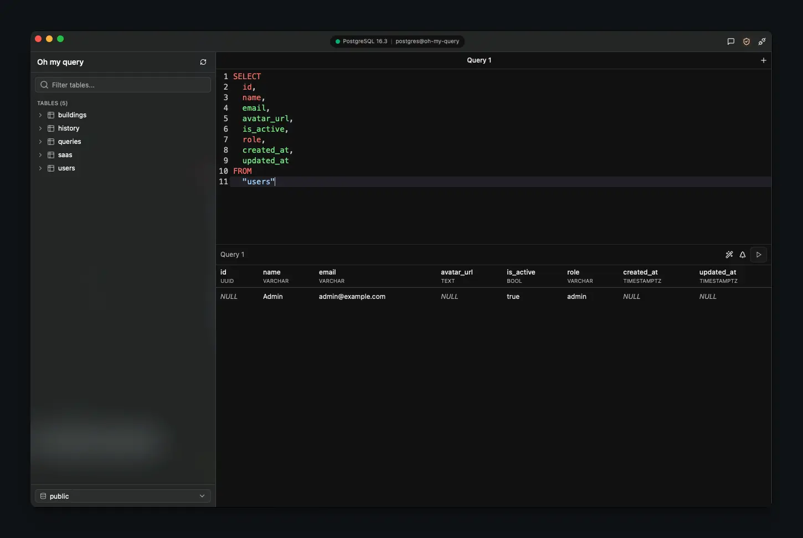

<div align="center">



# oh-my-query

A modern database client for querying with AI.

[](LICENSE)
[](https://github.com)
[](https://electrobun.dev)
[](https://react.dev)
[](https://www.typescriptlang.org)

</div>

<br />

> [!WARNING]
> This project is under active development. Features may change, break, or be incomplete. Use at your own risk.

<br />

oh-my-query is a database launcher for macOS. Press a hotkey, ask a question in plain words, and get a chart or a table from your own database. It works with eight database engines and is built for the keyboard.

<br />

## Features

### One panel, summoned by a hotkey

Press `Option + Shift + Space` from any app to open the launcher. It shows your recent answers, saved widgets, boards and connections. Press `Esc` and the focus goes back to the app you were using. The app lives in the menu bar and has no Dock icon.

### Ask, and see the answer

Type a question and press `Enter`. The panel shows the SQL as it is written, runs it read-only, and turns the result into a chart, a KPI or a table. Statements that change data are refused before they run. The AI reads your schema and works with **OpenAI**, **Anthropic**, **OpenRouter** and **local models** through Ollama or any OpenAI-compatible endpoint.

### Widgets: answers you keep

Save an answer as a widget with typed inputs: a region, a date range, a limit. Running a widget again uses the saved SQL and does not call the AI. Input values always go to the database as bind parameters, never as SQL text.

### Boards: widgets that stay on screen

A board is a separate window with a grid of widgets that refreshes on a schedule you choose. Inputs that widgets share, such as the same date range, appear once at the top of the board. When you change one, only the tiles that use it run again. Boards pause their refresh while they are hidden or minimized.

### Multi-database engines, one client

Connect to **PostgreSQL**, **MySQL**, **SQLite**, **Microsoft SQL Server**, **DuckDB**, **ClickHouse**, **MongoDB** and **Redis** from the same app.

### Write any dialect, run anywhere

[polyglot-sql](https://github.com/polyglot-sql/polyglot-sql) transpiles queries between dialects when they run, across 30+ SQL variants including BigQuery, Snowflake, DuckDB, ClickHouse and Spark.

### Native experience

Built with Electrobun. A translucent panel, dark mode by default, spring animations that you can interrupt, and full support for `prefers-reduced-motion`.

<br />

## Keyboard Shortcuts

### Launcher

| Shortcut                 | Action                                             |
| ------------------------ | -------------------------------------------------- |
| `Option + Shift + Space` | Open or close the launcher (change it in Settings) |
| `Up` / `Down`            | Move through the list                              |
| `Enter`                  | Ask, run the widget, or open the board             |
| `Tab`                    | Edit a widget's inputs before it runs              |
| `Cmd + K`                | Actions for the selected row                       |
| `Up` on an empty field   | Reopen the last answer                             |
| `Cmd + ,`                | Settings                                           |
| `Esc`                    | Go back, clear the field, then close               |

### Answers

| Shortcut          | Action                            |
| ----------------- | --------------------------------- |
| `Cmd + number`    | Switch between the answer's views |
| `Cmd + E`         | Show or hide the SQL              |
| `Cmd + C`         | Copy the SQL                      |
| `Cmd + S`         | Save as a widget                  |
| `Cmd + Shift + S` | Save as a widget with inputs      |
| `Esc`             | Stop a running answer             |

### Boards

| Shortcut                  | Action                                              |
| ------------------------- | --------------------------------------------------- |
| `Cmd + R`                 | Refresh every tile                                  |
| `Cmd + E`                 | Enter or leave edit mode                            |
| `Option + Left` / `Right` | Move the focused tile (edit mode)                   |
| `Option + Up` / `Down`    | Make the focused tile larger or smaller (edit mode) |
| `Esc`                     | Leave edit mode                                     |

<br />

## Installation

### Homebrew (macOS, recommended)

```bash
brew install --cask victor-teles/tap/oh-my-query
```

### Manual download

Grab the latest installer from the [GitHub Releases](https://github.com/victor-teles/oh-my-query/releases) page.

- **macOS** — `.dmg` for Apple Silicon and Intel
- **Windows** — `.msi` installer or portable `.exe`

<br />

## Development

### Prerequisites

- [Bun](https://bun.sh) v1.3.9+

### Getting started

```bash
# Install dependencies
bun install

# Start the renderer only (browser)
bun run dev:web

# Start the desktop app (Vite + Electrobun watcher)
bun run desktop:dev
```

The renderer runs at [localhost:3001](http://localhost:3001).

### Other commands

```bash
bun run build          # Build all apps
bun run check-types    # TypeScript across all workspaces
bun run check          # Lint + format check (Ultracite)
bun run fix            # Auto-fix lint/format
bun run --cwd apps/app test           # Vitest unit + hook tests
bun run --cwd apps/app test:coverage  # Vitest with the 40% gate
bun run --cwd apps/app e2e            # Playwright e2e against the Vite dev server
```

See [`TESTING.md`](TESTING.md) for the full story — coverage gates and fixture setup.

<br />

## Project Structure

```
oh-my-query/
├── apps/
│   └── app/                       # Electrobun desktop app
│       ├── src/
│       │   ├── mainview/          # React renderer
│       │   │   ├── routes/        # File-based routing (TanStack Router)
│       │   │   ├── components/    # UI components
│       │   │   ├── hooks/         # Shared React hooks
│       │   │   └── lib/           # Utilities, IPC bridge, browser stubs
│       │   └── bun/               # Bun-side process (launcher, board windows, RPC)
│       └── electrobun.config.ts
├── packages/
│   ├── agent/                     # AI ask pipeline (runs in the bun process)
│   ├── config/                    # Shared TypeScript config
│   ├── core/                      # Persistence, transpile, traits
│   ├── drivers/                   # SQL driver adapters
│   ├── drivers-redis/             # Redis driver
│   ├── env/                       # Type-safe environment variables
│   ├── rpc/                       # RPC schema shared across renderer + bun
│   └── vitest-visual/             # Visual testing utilities
├── turbo.json
└── package.json
```

<br />

## Tech Stack

**Frontend** — React 19, TanStack Router, Tailwind CSS v4, shadcn/ui, Motion, Recharts

**Desktop** — Electrobun, Bun runtime, Vercel AI SDK, TypeScript drivers for PostgreSQL/MySQL/SQLite/SQL Server/DuckDB/ClickHouse/MongoDB/Redis, polyglot-sql

**Tooling** — Turborepo, Bun, TypeScript 5, Vitest, Ultracite (Oxlint + Oxfmt)

<br />

## Contributing

Contributions are welcome. Here's how to get started:

1. Fork the repository
2. Create a feature branch (`git checkout -b my-feature`)
3. Make your changes
4. Run `bun run fix` to lint and format, then `bun run test`
5. Commit and open a pull request

<br />

## License

[MIT](LICENSE)
